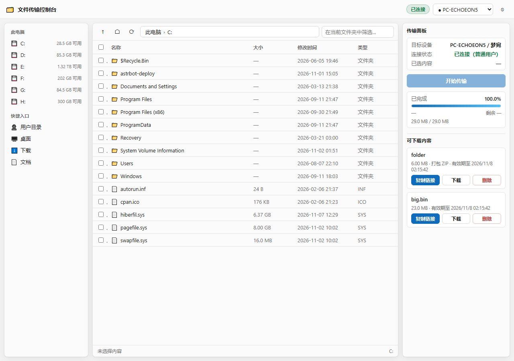
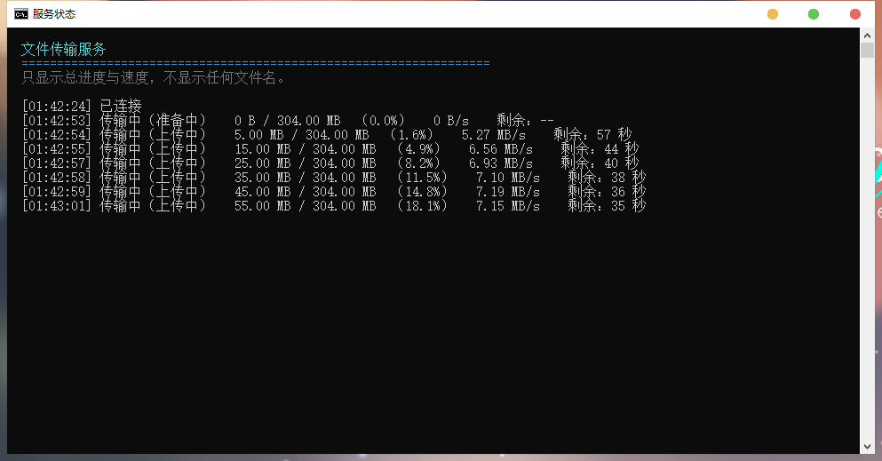
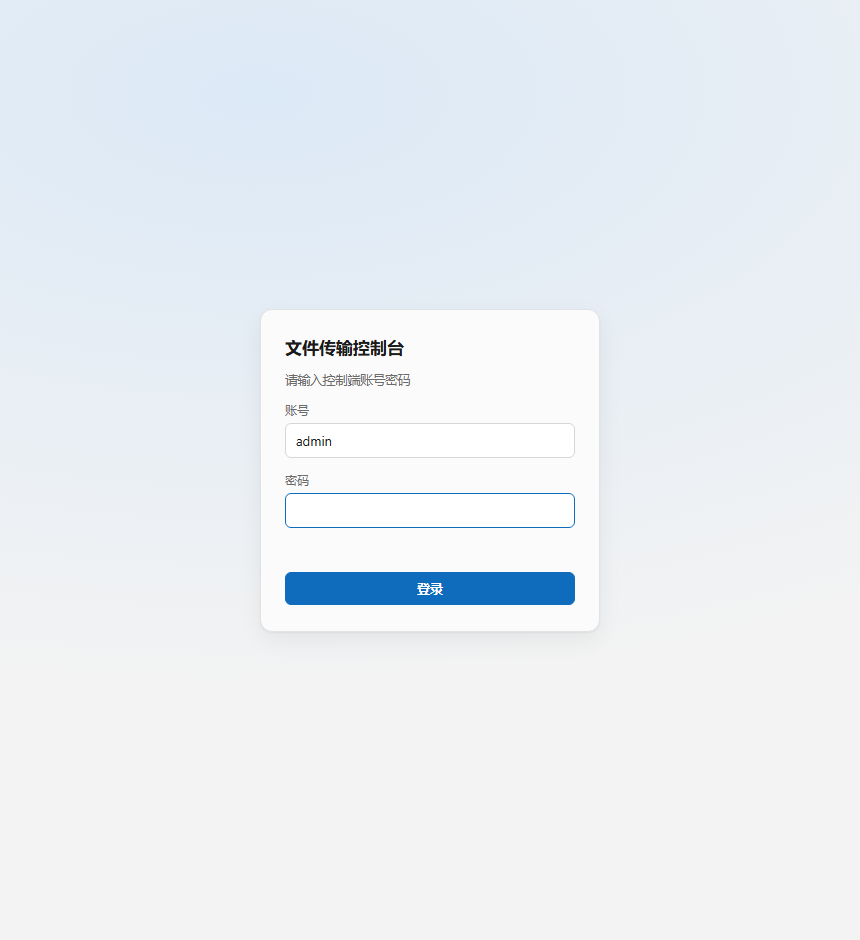

# 跨公网大文件传输 · Relay

[](https://www.python.org/)


[](#许可)

**把别人电脑上的 10–20 GB 大文件跨公网搬回自己电脑：目标端只放 1 个 bat，你这边只用浏览器。文件字节直传阿里云 OSS，从不经过中继服务器。**

> Move 10–20 GB files off someone else's PC to yours: one `.bat` on the source machine, a browser on yours. Bytes stream straight to Aliyun OSS — the relay never touches file data.



把别人电脑上的大文件（10–20 GB 级）搬到你自己电脑上：

**目标电脑只放 1 个 bat，你自己这边只用浏览器。**

```
目标电脑（别人的电脑）                你的 Linux 服务器            阿里云 OSS
 传输助手.bat
   ├─ 控制指令 / 进度 ─────────────▶ relay.py（只转发几十字节）
   │                                    │
   │                                    ├─ 分片签名 / 合并 ──────▶ 私有桶
   └─ 文件字节 ══════════════════════════════════════════════════▶ 私有桶

你的电脑（浏览器 / 手机 / 平板）
   └─ 点选文件 / 看进度 / 取下载链接 ──▶ relay.py ──签名直链──▶ 私有桶
```

**文件字节从不经过服务器。** 目标机直传 OSS，你从 OSS 直接下载，
所以服务器 1 核 1G 就够，不需要买带宽，20 GB 走下来服务器流量几乎为 0。

---

## 特性

| | |
|---|---|
| **大文件** | 分片直传 + 断点续传，实测 1 GB（200 分片）字节级校验一致；设计目标 20 GB |
| **文件夹** | 边打包 ZIP（store 模式 + ZIP64）边上传，**不落临时文件**，目录结构与空目录原样保留 |
| **下载** | 预签名直链，中文文件名正常，支持 IDM / 迅雷多线程与 Range 断点 |
| **零依赖** | 服务器只用 Python 3 标准库；目标端只用系统自带 PowerShell 5.1，**不需要管理员** |
| **隐私** | 目标机窗口只显示总进度和速度，**不显示任何文件名** |
| **Web 文件管理** | 新建文件夹 / 新建文件 / 重命名 / 复制 / 移动 / 删除，桌面右键、手机长按 |
| **受限目录** | 遇到 `System Volume Information` 这类无权目录不再报错中断，明确标注原因并保持可返回上级 |
| **三端适配** | 电脑鼠标操作、平板/手机触屏自适应（按钮加大、整行点选、长按菜单） |
| **双向传输** | 既能把目标机的文件取回来，也能**把本机文件发到目标机**（浏览器直传 OSS，目标机再拉下来） |

---

## 界面

| 目标端（别人的电脑） | 控制台登录 |
|---|---|
|  |  |

目标端窗口只显示总进度与速度，**不出现任何文件名**（这是刻意的隐私设计）。

---

## 三步部署

### 1. 准备阿里云 OSS

建一个**私有** Bucket，建一个 RAM 子账号给它读写权限，记下：
Bucket 名、Endpoint（如 `oss-cn-hangzhou.aliyuncs.com`）、AccessKeyId、AccessKeySecret。

生命周期（7 天自动清理）和**跨域规则（CORS）**都由第 2 步的安装脚本自动写入，不用你手动点。
CORS 是反向上传的前提：浏览器要把文件直接 PUT 到 OSS，桶不支持跨域就会报「上传时网络中断」。

### 2. 部署中继（Linux）

```bash
# 方式 A：一键（自解压，自动建用户、装 systemd、跑自检）
scp dist/relay-install.run root@你的服务器:/root/
ssh root@你的服务器 'bash /root/relay-install.run'

# 方式 B：手动
scp -r server root@你的服务器:/opt/server
ssh root@你的服务器 'cd /opt/server && python3 setup.py'   # 交互式填配置
ssh root@你的服务器 'systemctl enable --now relay'
```

### 3. 生成目标端 bat

```bash
# 命令行
python build.py --relay http://你的IP:8080 --key 你的设备密钥

# 或发给别人用图形界面
dist/信息传输助手生成器.exe
```

把生成的 `传输助手.bat` 发到目标电脑，双击即可。

---

## 配置（改这里就能复用，代码一行不用动）

配置文件 `server/config.json`。**用户只需要填下面标 ★ 的几项，其余保持默认即可。**

| 字段 | 说明 |
|---|---|
| `listen` / `port` | 监听地址与端口，默认 `0.0.0.0:8080` |
| ★ `public_base` | 浏览器访问用的对外地址，如 `http://1.2.3.4:8080`；留空则自动推断 |
| ★ `password` | 网页登录密码 |
| ★ `device_key` | 目标端接入密钥，写进 bat；**泄露等于别人能连你的服务器** |
| ★ `oss.endpoint` | 如 `oss-cn-hangzhou.aliyuncs.com` |
| ★ `oss.bucket` | 私有桶名 |
| ★ `oss.access_key_id` / `oss.access_key_secret` | RAM 子账号密钥 |
| `oss.part_size` | 分片大小，默认 8 MB（64 MB 也可，见性能一节） |
| `oss.download_expires` | 下载链接有效期，默认 86400 秒（24 小时） |
| `lifecycle.days` | 桶内对象保留天数，默认 **7**；到期 OSS 自动删除 |
| `lifecycle.enabled` | 默认 `true`；设 `false` 不自动删 |
| `lifecycle.abort_multipart` | 默认 `true`；顺带清理未完成分片 |
| `session_hours` / `max_fail` / `lock_seconds` | 登录会话与防爆破参数，一般不用改 |

`lifecycle` 是**基础设置**，所有人默认一致，由安装脚本自动应用到 OSS。
改完要重跑一次才生效：

```bash
sudo -u relay python3 /opt/server/tools/setup_oss.py --apply
```

改完重启：`systemctl restart relay`。

自检（会真连一次 OSS，把错误翻译成中文）：

```bash
python doctor.py
```

---

## 传输方式（三选一）

生成 bat 时可选，也可以改 `client/配置.txt` 里的「传输方式」：

| 选项 | 含义 | 适用 |
|---|---|---|
| **仅 OSS**（默认） | 数据全部经阿里云 OSS 中转 | 任何网络，兼容性最好 |
| **IPv6 优先** | 双方都有公网 IPv6 时直连，否则自动回落 OSS | 想要速度、且不想付 OSS 流量 |
| **仅 IPv6** | 只用 IPv6，绝不回落 | 明确要求数据不落第三方存储 |

### IPv6 直连是怎么工作的

选 IPv6 时，目标端会在本机开一个只监听 IPv6 的临时 HTTP 服务，
浏览器**直接从目标电脑拉文件**，字节完全不经过中继服务器，也不产生 OSS 流量。

- 每个文件一个一次性令牌，浏览器生成、双方都不知晓就不给下
- 支持断点续传（HTTP Range），浏览器/迅雷/IDM 都能多线程拉
- 中继只负责传话（谁在哪儿、端口多少），不碰文件内容
- 页面上的传输方式面板会显示「就绪 · 端口 xxxx · N 个文件」

**三条必须知道的限制：**

| 限制 | 说明 |
|---|---|
| 双方都要有公网 IPv6 | 目标电脑和你的浏览器都要有。国内很多家宽/手机流量已支持，公司网常没有 |
| **不支持文件夹** | 直连只能逐个文件传。选了文件夹时，「IPv6 优先」会自动改走 OSS， 「仅 IPv6」会明确报错而不是偷偷换路 |
| 链接在刷新页面后丢失 | 令牌只存在浏览器里、不落服务器（这是刻意设计）。刷新后重新点一次「创建传输任务」即可 |

> 本项目的 IPv6 直连能力在**回环 `::1` 上完成了完整功能验证**（下载、断点、
> 并发、鉴权、回落）。但开发和部署所用的服务器本身没有公网 IPv6，
> 所以**没有在真实公网 IPv6 链路上验证过**。请以你自己环境的实际探测结果为准——
> 页面会明确告诉你「连不上」还是「已就绪」，不会假装成功。

目标端窗口长这样：

```
  信息传输服务
  ==================================================================
  控制台地址：http://你的IP:8080
  用浏览器打开上面这个地址，即可查看与控制本机。
  传输方式  ：IPv6 优先，失败回落 OSS
  当前通道  ：IPv6 直连，端口 51234
              本机 IPv6：2408:8207:xxxx:xxxx::1
  ------------------------------------------------------------------
  只显示总进度与速度，不显示任何文件名。
```

---

## 交付物

| 文件 | 说明 |
|---|---|
| `dist/传输助手.bat` | 给目标电脑的**唯一**文件（≈105 KB，无依赖、不提权） |
| `dist/信息传输助手生成器.exe` | 图形界面生成器：填地址/密钥/传输方式，点一下就出 bat |
| `dist/配置生成器.zip` | 免编译版：改 `配置.txt` → 双击 `生成传输助手.bat` |
| `dist/relay-install.run` | 服务器一键部署（自解压） |
| `dist/relay-deploy.tar.gz` | 服务器文件包（手动部署用） |
| `server/` | 中继服务（Python 3 标准库，无第三方依赖） |
| `server/web/` | 控制台前端（单文件，样式与逻辑内联） |
| `client/agent.ps1` | 目标端载荷（被 `build.py` 嵌进 bat） |
| `setup.py` | 交互式配置向导，生成 `server/config.json` |
| `doctor.py` | 部署自检 |
| `build.py` / `build_exe.py` / `pack_all.py` | 打包脚本 |

---

## 本机跑一遍（不需要真 OSS）

```bash
# 1. 假 OSS（--throttle-mbps 可模拟公网限速；自带 CORS，浏览器可直传）
python tools/fake_oss.py --port 9000 --dir _fakeoss --throttle-mbps 20

# 2. 中继（config.test.json 已把 OSS 指到假 OSS）
python server/relay.py --config server/config.test.json          # 监听 8081

# 3. 目标端
#    先设环境变量 RELAY_URL=http://127.0.0.1:8081 / DEVICE_KEY=local-dev-key-0001
powershell -ExecutionPolicy Bypass -File client/agent.ps1 -Mode worker

# 4. 浏览器打开 http://127.0.0.1:8081/   账号 admin / Test@12345
#    右下「发到目标电脑」可以试反向上传（浏览器 → 假 OSS → 目标端）
```

不想用真目标端时可用模拟器：

```bash
python tools/mock_target.py --base http://127.0.0.1:8081 --key local-dev-key-0001
```

---

## 测试

```bash
# 目标端文件操作单元测试（真实磁盘）
powershell -ExecutionPolicy Bypass -File tests/test_fsops.ps1      # 20 项

# 端到端（真实中继 + 真实 worker + 假 OSS）
python tests/test_e2e_fsops.py                                      # 16 项

# 界面端到端（真实浏览器 CDP + 真实磁盘，需先起环境）
python tests/dev_ui_env.py                                          # 起测试环境
python tests/test_ui_fsops.py                                       # 43 项

# IPv6 直连：服务本体单元测试（真实回环 ::1）
powershell -ExecutionPolicy Bypass -File tests/test_v6serve.ps1     # 22 项

# IPv6 直连：端到端（真实中继 + 真实 worker + 真实下载）
python tests/test_v6_e2e.py                                         # 26 项

# IPv6 直连：界面端到端（真实浏览器，含回落与拒绝逻辑）
python tests/test_ui_v6.py                                          # 21 项

# IPv6 直连：吞吐探针（curl，不经过 PowerShell 客户端瓶颈）
python tests/perf_v6.py

# ZIP 打包自测（真打包再解压比对 SHA256）
powershell -ExecutionPolicy Bypass -File tests/test_zip.ps1

# 反向上传：数据面（真实中继 + 真实 worker + 假 OSS）
python tests/test_rev_e2e.py                                        # 23 项

# 反向上传：界面端到端（真实浏览器，假 OSS 会自动起在随机空闲端口）
python tests/test_ui_rev.py                                         # 18 项

# 反向上传：生产验收（打真实中继 + 真实 OSS，只用 ~2 KB 文件）
# 需要把文件里的 URL / 账号 / device_key 改成你自己的
python tests/test_prod_rev.py                                       # 10 项
```

> `test_ui_rev.py` 会自动挑一个空闲端口起假 OSS，并在结束时清理进程。
> 早期版本用固定端口 9102，多次运行后残留进程会让浏览器的预检请求打到旧进程上，
> 表现为「上传时网络中断」却查不到原因——现在已不会发生。

---

## 已真实验证

| 场景 | 结果 |
|---|---|
| 24 MB / 200 MB / 304 MB 分片上传合并 | SHA256 与源文件一致 |
| 1 GB 文件（200 分片）+ 文件夹 + 小文件混合 | 全部一致；内存稳定 ~107 MB，无泄漏 |
| 文件夹（多层级 / 中文名 / 空目录 / 0 字节文件）→ ZIP | 解压后逐文件 SHA256 一致，空目录保留 |
| 上传中途取消 / 中断后重开 | 立刻停；自动跳过已传分片，合并且一致 |
| 预签名下载 + Range 断点 | 206 部分内容，字节一致 |
| 中文文件名下载 | `filename*=UTF-8''…`，浏览器显示原名 |
| 中继重启 | 作业与下载链接自动恢复，指令游标自动重置 |
| 真实阿里云 OSS | 分片直传、合并、签名下载全线跑通 |
| 目标端窗口隐私 | 全程只出现总进度/速度，不含任何文件名（已断言） |
| Web 文件管理（建/改名/复制/移动/删除） | 界面端到端 43 项全绿，每步回查磁盘真实结果 |
| 受限目录（System Volume Information 等） | 明确提示原因，可返回上级，不中断 |
| 手机 / 平板 / 桌面三端布局 | 触屏自动切加大按钮与长按菜单 |
| IPv6 直连数据面（回环 `::1`） | 完整下载 / Range 断点 206 / 越界 416 / 错令牌 403 / 未知文件 404 / 8 路并发，字节全部一致 |
| IPv6 直连吞吐（回环） | 单连接 165 MB/s，8 路并发聚合 223 MB/s |
| IPv6 指令链路（真实中继 + worker） | 26 项全绿：登记、下发、真实下载、状态上报、停止清空 |
| IPv6 界面流程（真实浏览器） | 21 项全绿：面板标注、直链生成、真实下载、文件夹回落 OSS、仅 IPv6 拒绝与报错 |
| 反向上传数据面（真实中继 + 真实 worker） | 23 项全绿：单点/分片上传、分片数不符拒绝、合并、预签名下载、目录自动创建、同名自动改名、非法文件名跳过、字节一致、无分片残留 |
| 反向上传界面（真实浏览器） | 18 项全绿：登录、目录导航、选择本机文件、真实 PUT 上传、进度、文件落盘、`direction=in`、日志校验 |
| 反向上传生产验收（真实 ECS + 真实 OSS） | 10 项全绿：登录、预签名、真实 OSS PUT、目标端上线、pull 指令、落盘、字节一致、`direction=in`、作业完成、日志 |

**尚未真实验证**：**跨公网** IPv6 直连（本机与现有 ECS 都没有公网 IPv6，
只在回环 `::1` 上验证了功能与回落逻辑）；企业网络对非 443 端口的放行情况；
真实公网上传速度。

---

## 安全提示

- `传输助手.bat` 里含 `device_key`，**不要公开发布**；泄露等于别人能连你的服务器。
  给不同的人用就分别生成不同的 key。
- `server/config.json` 含 OSS 密钥，权限设成 `600`，只给服务用户读。
- 默认是 **HTTP 明文**，登录密码会被同网段嗅探到。要上公网请在前面加 Nginx + TLS。
- OSS 桶保持**私有**，下载一律走预签名直链，不要开公共读。

---

## 常见问题

见 [`常见问题.md`](常见问题.md)。

---

## 许可

MIT License

Copyright (c) 2026 <EchoEon5>

Permission is hereby granted, free of charge, to any person obtaining a copy
of this software and associated documentation files (the "Software"), to deal
in the Software without restriction, including without limitation the rights
to use, copy, modify, merge, publish, distribute, sublicense, and/or sell
copies of the Software, and to permit persons to whom the Software is
furnished to do so, subject to the following conditions:

The above copyright notice and this permission notice shall be included in all
copies or substantial portions of the Software.

THE SOFTWARE IS PROVIDED "AS IS", WITHOUT WARRANTY OF ANY KIND, EXPRESS OR
IMPLIED, INCLUDING BUT NOT LIMITED TO THE WARRANTIES OF MERCHANTABILITY,
FITNESS FOR A PARTICULAR PURPOSE AND NONINFRINGEMENT. IN NO EVENT SHALL THE
AUTHORS OR COPYRIGHT HOLDERS BE LIABLE FOR ANY CLAIM, DAMAGES OR OTHER
LIABILITY, WHETHER IN AN ACTION OF CONTRACT, TORT OR OTHERWISE, ARISING FROM,
OUT OF OR IN CONNECTION WITH THE SOFTWARE OR THE USE OR OTHER DEALINGS IN THE
SOFTWARE.
